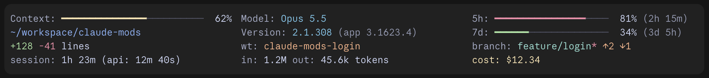

# claude-mods

Mods I find useful when working with Claude, mainly [Claude Code](https://claude.com/claude-code), developed here as the need comes up and shared so that anyone can install them. A mod is a Claude Code plugin of function hooks: a small TypeScript module that changes how Claude Code looks or behaves, in the terminal and in the desktop app. The repository is a plugin marketplace, so each mod installs with one line.

| Mod | What it does |
|---|---|
| [`statusline`](./statusline) | Draws the [claude-statusline](https://github.com/mayoral/claude-statusline) status line as a band above the prompt: context bar, rate limits, git branch, lines changed, tokens and cost, with Catppuccin colors that follow light and dark mode. Works in the desktop app and in the terminal. |



## Installing a mod

Each mod's folder has a README with its own install, use and configuration notes. The steps are the same for all of them; `statusline` stands in for any mod below.

**From a terminal session.** At the prompt:

```
/plugin install statusline --marketplace mayoral/claude-mods
```

Claude Code asks `Add marketplace?` the first time, naming `github:mayoral/claude-mods`: answer `y`. Then pick a scope, `user` being the usual one, so the mod loads in every session on the machine. A mod with options shows a screen to set them, and the mod is active from then on, with no restart.

**From a shell.** The same, outside a session:

```bash
claude plugin install statusline --marketplace mayoral/claude-mods
```

**In the desktop app**, where `/plugin` does not run: click **+** next to the prompt box, then **Plugins**, **Add marketplace** with `mayoral/claude-mods`, then **Add plugin**. A mod installed from a terminal at the user scope loads in the desktop app's sessions too.

**Afterwards.** `claude plugin update statusline` brings the latest version (restart to apply), `claude plugin uninstall statusline` removes it, and `claude plugin list` shows what is installed. A mod's options are changed from `/config`, under the plugin's rows, or with `claude plugin configure statusline`.

**Trying a mod without installing it.** Clone the repository and start a terminal session with the mod's folder:

```bash
claude --plugin-dir ./statusline
```

The folder is watched, so every save reloads the mod. For a session the desktop app starts, name the folder in `CLAUDE_CODE_PLUGIN_DIRS` in the `env` block of `~/.claude/settings.json`.

## Layout

Each mod lives in its own folder, with the files the engine reads:

```
<mod>/
  .claude-plugin/plugin.json   the manifest: name, version, options
  hooks/hooks.json             names the hooks module
  hooks/register.tsx           the hooks module: export const register = (on, options) => { ... }
  types/index.d.ts             the mod's $.state contract, when it keeps values there
  tests/*.test.tsx             run by `claude plugin test <mod folder>`
  README.md
```

`.claude-plugin/marketplace.json` at the root lists every mod; a new mod is a new folder and a new entry there.

## Developing

- `claude plugin validate <mod folder>` reads the manifest and the hooks module the way the engine will, and reports everything it would refuse.
- `claude plugin test <mod folder>` runs the mod's tests.
- `claude --plugin-dir <mod folder>` loads a mod from disk for one session, hot-reloading it on every save.

## License

[MIT](./LICENSE)
