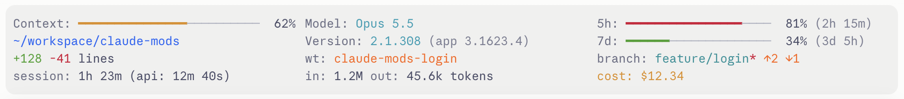
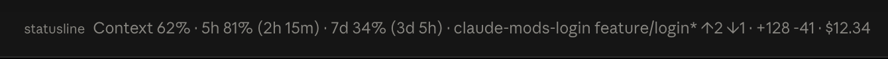
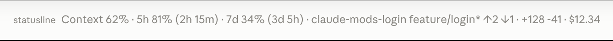

# statusline

A Claude Code mod that draws the [claude-statusline](https://github.com/mayoral/claude-statusline) status line as a band above the prompt, so the same figures show in the desktop app and in the terminal. Four rows of three columns, each cell left out when its data is absent:

```
Context bar      | Model    | 5h rate limit
Project dir      | Version  | 7d rate limit
Lines changed    | Worktree | Git branch
Session duration | Tokens   | Cost
```




- **Context bar**: a progress bar for context-window usage, green under 50 %, yellow under 80 %, red past it.
- **Rate limits**: the 5-hour and 7-day usage bars, each with a `(2d 3h)`-style countdown to its reset.
- **Git**: the current branch (or `@sha` when detached), a dirty marker (`*`), ahead/behind arrows (`↑2 ↓1`) and a `wt:` cell inside a linked worktree.
- **Session stats**: lines added and removed by the edit tools, input and output tokens, wall-clock and model-request time, running cost in USD.
- **Version**: Claude Code's, the engine running the session, as the script shows it; in a session the desktop app started, the app's version beside it (`2.1.308 (app 3.1623.4)`).

The colors follow [Catppuccin](https://catppuccin.com), Latte on a light background and Mocha on a dark one, chosen by the mode the app or the terminal is in.

## Install

At the prompt of a terminal session:

```
/plugin install statusline --marketplace mayoral/claude-mods
```

Answer `y` to add the marketplace the first time, then pick a scope (`user` loads it in every session). From a shell:

```bash
claude plugin install statusline --marketplace mayoral/claude-mods
```

In the desktop app, where `/plugin` does not run: click **+** next to the prompt box, then **Plugins**, **Add marketplace** with `mayoral/claude-mods`, then **Add plugin**. A mod installed from a terminal at the user scope loads in the desktop app's sessions too.

Git cells need `git` on the host. Nothing else is required. `claude plugin update statusline` brings the latest version (restart to apply); `claude plugin uninstall statusline` removes it.

## Use

The band shows by itself from the first turn and redraws after each turn, when a rate-limit window moves, half a second after a tool call that may have touched the working tree, and once a minute so the countdowns keep moving.

One slash command controls it:

| Command | Effect |
|---|---|
| `/statusband` | Toggles the band |
| `/statusband off` | Hides it, and keeps it hidden across sessions |
| `/statusband on` | Shows it again |
| `/statusband refresh` | Reads every figure again now |
| `/statusband demo` | Fills every cell with made-up figures, for a screenshot |
| `/statusband live` | Brings the real figures back |

**Status line under the prompt.** Besides the band, the mod can pin a one-line summary under the prompt, as its own status line:





The desktop app hides the band behind its own next-step box, and the line is what stays readable there, so by default it is pinned only while the desktop app is attached. The `statusLine` option pins it always, or never. It follows `/statusband` on and off.

**Narrow bands.** The three columns are kept wherever they fit. The grid needs 118 cells (two columns of 40 and the widest rate cell); on a narrower band the columns and the bars shrink together, and only when a bar would fall under 8 cells do the cells reflow into two columns or one.

**Diagnosing.** The mod registers one tool for the model, `mcp__statusline__inspect`, which reports what the band last drew (surface, width in cells, columns chosen, rows) and the figures it holds; with `demo` set it also switches the demo figures on or off. When the band looks wrong, ask Claude to call it.

## Configuration

The options live in `/config`, under the plugin's rows, or are set with `claude plugin configure statusline`. A change reloads the mod.

| Option | Meaning | Default |
|---|---|---|
| `theme` | `catppuccin` (Latte or Mocha by the mode in use), `catppuccin-latte`, `catppuccin-mocha` (one of them, always) or `default` (the script's terminal colors) | `catppuccin` |
| `statusLine` | The one-line summary under the prompt: `desktop` (while the desktop app is attached), `always` or `off` | `desktop` |
| `col1Width` | Width of the first column, in cells | `40` |
| `col2Width` | Width of the second column, in cells | `40` |
| `contextBarWidth` | Width of the context-window bar, in cells | `25` |
| `rateBarWidth` | Width of each rate-limit bar, in cells | `20` |

**How the light or dark variant is chosen.** In the desktop app, from the app's own Appearance setting, read from its config file (`userThemeMode`); set to System, from macOS (`defaults read -g AppleInterfaceStyle`). In the terminal, from the **Theme** row of `/config` (`auto` counts as dark). Both are read once a minute and after each turn, so a switch shows within the minute. Where none of that can be read, force a variant with `theme`.

**What each color paints.** Labels in Subtext0 and plain values in Text; model and version in Sapphire; the branch in Teal; the project directory in Blue; the worktree and the arrows in Peach; the cost in Yellow; lines added and bars under 50 % in Green, bars from 50 % in Yellow, lines removed, the dirty marker and bars from 80 % in Red; the unfilled part of a bar in Surface2. With `theme` set to `default` the script's own colors apply and each bar is drawn in one color, as the script draws it.

## Where the figures come from

The engine reports the context fill, the rate-limit windows, the cost, the model, the version and the directories; git is read with the same two commands the script runs. The mod counts for itself what the engine does not report:

- **Lines changed**: the file before and after each `Edit`, `Write` or `NotebookEdit` call, diffed by line. Edits made through shell commands are not counted, as in the original status line.
- **Output tokens**: summed over each turn, subagents included.
- **Model-request time**: from each request to the end of its stream.

The model is shown by its display name, `claude-fable-5-1` as `Fable 5.1`.

## Developing

`claude plugin validate <folder>` checks the manifest and the hooks module; `claude plugin test <folder>` runs the tests in `tests/`. To run the mod from its folder without installing it, start Claude Code with `--plugin-dir <folder>`, or name the folder in `CLAUDE_CODE_PLUGIN_DIRS` for a session the desktop app starts; every save reloads it.

## License

[MIT](../LICENSE)
